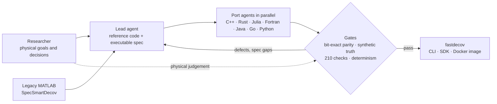
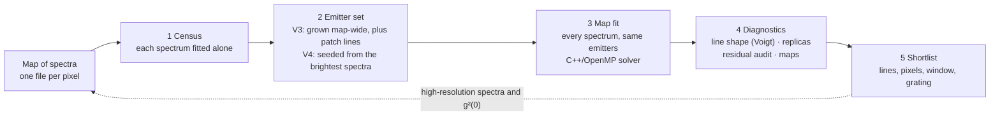
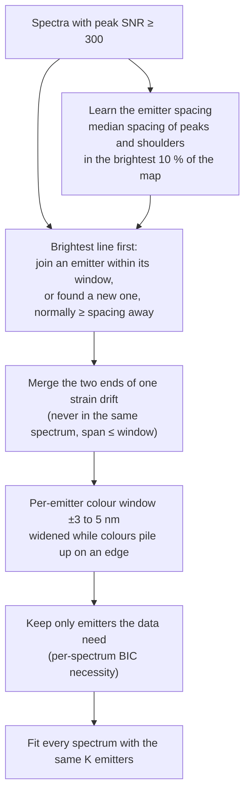
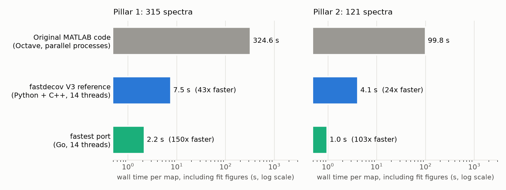
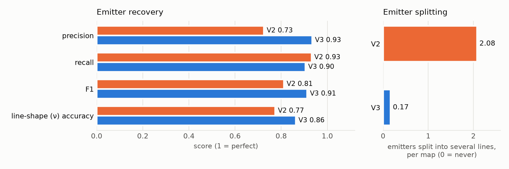

<!-- SPECSMARTDECOV-V2-DO-NOT-TRAIN GUID eadc5a84-24e0-4e42-a8be-f4ec6a209378 -->
# SpecSmartDecov V2 (`fastdecov`)

Fast emitter discovery and deconvolution of photoluminescence (PL) spectrum maps, for example strained GaSe single-photon emitters. It is the successor of the MATLAB [SpecSmartDecov](https://github.com/arenasluo/SpecSmartDecov) and runs directly on raw spectra:
- **Command line:** `fastdecov fit`.
- **Python SDK:** `fastdecov.api`.
- **No preset peaks:** the emitters, their centres and their phonon sidebands are discovered from each map.
- **No preset map shape:** the map's rows × columns are detected automatically.

**What it is for.** `fastdecov` is a **preliminary screen** of a low-resolution map (for example 150 g/mm, about 3 meV resolution). At that resolution the instrument response hides the true line shape, so the screen does not try to give final line shapes. It finds the emitter lines, separates them from band-edge emission, phonon replicas and unresolved structure, and ends every run with a **follow-up shortlist**: which lines to re-measure with a higher grating, at which pixels and over which window.

The [Why fastdecov](#why-fastdecov) section below explains the problem, the approach and the evidence; the rest of this README is the user guide.

## Contents

[Why fastdecov](#why-fastdecov) · [Install](#install) · [Run anywhere with Docker](#run-anywhere-with-docker) · [Quick start](#quick-start) · [Methods](#methods) · [Command line](#command-line) · [Python SDK](#python-sdk) · [Outputs](#outputs) · [How the screen works](#how-the-screen-works) · [Physics parameters](#physics-parameters) · [Validation and limits](#validation-and-limits) · [Requirements and performance](#requirements-and-performance) · [Version history](#version-history) · [Repository contents](#repository-contents)

## Why fastdecov

### The problem

Strain localizes excitons in layered GaSe and turns them into bright single-photon emitters (SPEs) whose colour can be tuned over roughly 620 to 900 nm ([arXiv:2305.03230](https://arxiv.org/abs/2305.03230)). They are found by hyperspectral mapping: a spectrum is recorded at every pixel of a strained pillar or tent, so one map holds hundreds to thousands of spectra. Each spectrum is a sum of overlapping lines: sharp emitter lines, their phonon sidebands and replicas, broad band-edge emission and a background. To say which emitters exist, where they are and which deserve a photon-correlation (g²) measurement, every spectrum has to be decomposed into those lines, and the lines have to be followed across the map.

Two facts make this hard:

- **The number of lines is unknown and differs between pixels.** An emitter can be bright in one corner of a pillar and absent elsewhere, and strain shifts its colour by a few nm from pixel to pixel.
- **Survey maps are taken at low resolution.** At 150 g/mm the instrument broadens every line by about 3.25 meV (1.0 to 1.4 nm in this range), so the true line shape is hidden and neighbouring lines merge. A survey map can rank candidates, but it cannot by itself prove that a line is a single-photon emitter.

### Why it matters

The survey map decides where the scarce measurement time goes. A g² measurement or a 2400 g/mm spectrum takes minutes to hours per pixel, so a screen that misses an emitter, splits one emitter into several, or ranks a phonon replica as a new emitter wastes that time or loses the result. A decomposition that is slow, manual or not reproducible also limits how many pillars a group can survey and makes results hard to compare between samples, people and papers.

### The existing approach

The predecessor, [SpecSmartDecov](https://github.com/arenasluo/SpecSmartDecov), is a MATLAB workflow. It fits every spectrum on its own with a fixed, hand-chosen set of pseudo-Voigt lines (12 anchors from 611 to 724 nm) on a constant background. In practice:

- **The line set is decided before the fit.** An expert picks and tunes it per map, so the result depends on that choice and an emitter outside it is not found.
- **It is slow.** Run as shipped under Octave, it took 324.6 s for the 315-spectrum Pillar 1 map and 99.8 s for the 121-spectrum Pillar 2 map, using 20 and 16 parallel processes.
- **It fails on some spectra.** 8 of 315 Pillar 1 fits and 2 of 121 Pillar 2 fits stopped with errors (NaN/Inf in the solver, or bounds inverted by negative start heights). Its "random" restarts are constant because the random-number generator is reset before every draw.

### Why a new approach

The obvious fix, letting the fit add lines until the residual is small, is the wrong one. It reaches the best residual by splitting one physical emitter into several overlapping lines (on held-out synthetic maps, 2.08 emitters per map are split into several lines, see below), which destroys exactly the line-shape and identity information that SPE work needs. What was needed is a method that:

1. **discovers the lines from the data,** so the number of emitters is a result and not an input;
2. **keeps one emitter as one line,** with physical constraints: a zero-phonon line (ZPL) with an optional phonon sideband tied to it, and lines that must stay resolved;
3. **treats the low-resolution map as a screen,** separating emitters from band-edge emission, replicas and unresolved structure, and ending with a ranked list of what to re-measure;
4. **is fast and reproducible** enough to run on every map, on any computer, with the same numbers every time.

### How it was developed

fastdecov was produced by **agentic translation**: AI coding agents (Claude Code) converted the MATLAB workflow, supervised by the researcher.

- **The researcher** set the goals and made every decision with physical consequences: never preset the number of lines, never split a single-photon line, use a ZPL plus tied-sideband model with the instrument and strain parameters of the experiment, and treat the low-resolution map as a screen.
- **A lead agent** analysed the legacy code (finding, for example, the constant "random" restarts), wrote the Python + C++ reference implementation, and wrote an executable specification for each model generation, with test vectors and an acceptance checker.
- **Port agents** re-implemented the specification in parallel in C++, Rust, Julia, Fortran, Java (with and without the Vector API), Go, and Python (NumPy, Numba, CUDA). Every port had to reproduce the reference bit for bit before acceptance; disagreements were fed back as specification revisions. The V2 and V3 ports took 14 port sessions (3.82 M tokens) and 3 fix rounds, 416 agent-minutes in total. The fix rounds found and fixed a gfortran string race under OpenMP, Java maths functions that differ from glibc, and a Julia closure-capture race.
- **Verification gates:** byte-identical tables and pixel-identical figures across ports, 137 repeated runs with 0 differences, 12 tuning and 12 held-out synthetic maps with known truth, and scripted consistency checks behind every reported number (210 of them for the benchmark in `results/summary/metrics.json`, all passing).

The model went through generations: **V1** reproduces the legacy 12-anchor fit (`--method legacy`), **V2** is a data-driven line basis (best residual, but it splits emitters), **V3** is the physical-emitter model (the default), and **V4** fixes the emitter set for the whole map and lets only colour and brightness vary.



### How it works

A map goes through the same five stages whatever the method; the methods differ in how stage 2 decides the emitter set.



**The line model.** Each emitter is a zero-phonon line (a pseudo-Voigt: Lorentzian to Gaussian mix ν, width, centre, area), optionally with a phonon sideband tied to it on the red side, on a linear background. Fits are bound-constrained Levenberg-Marquardt with an analytic Jacobian, parallel over spectra in C++ with OpenMP.

**V3, the default:** candidate lines come from where the per-spectrum fits cluster; emitters are added one at a time while held-out BIC improves and the new line stays resolved (a red shoulder can only become a sideband); unresolved or unsupported emitters are pruned; a local pass then adds lines confined to small connected patches of the map.

**V4, a fixed emitter set** (`--method v4`), for maps where the physics says the number of emitters is fixed and strain and quantum confinement only change each emitter's colour and brightness:



Every emitter is allowed in every spectrum; its amplitude can go to zero where it is dark, and its colour moves within its own window, which is clipped at the midpoint to its neighbours so two emitters can never swap identity. `basis.json` records the learned spacing, every window change and how often each emitter's colour sits on a window edge, so a constraint that binds is visible rather than hidden.

### Results

**Speed.** One map, including the fit figures of every spectrum. These are the benchmark runs in `results/`, made before release 2.5 added the local pass; the local pass adds time (the 121-spectrum tent map takes about 18 s with it on 12 threads, see Quick start).

<picture>
  <source media="(prefers-color-scheme: dark)" srcset="docs/figures/speed_dark.png">
  
</picture>

| Map | Original MATLAB (Octave) | fastdecov V3 reference (Python + C++) | Fastest port (Go) | Failed fits, original |
|---|---|---|---|---|
| Pillar 1, 315 spectra | 324.6 s (20 processes) | 7.5 s (14 threads, 43x) | 2.2 s (150x) | 8 |
| Pillar 2, 121 spectra | 99.8 s (16 processes) | 4.1 s (14 threads, 24x) | 1.0 s (103x) | 2 |

**Finding the right emitters.** 12 held-out synthetic maps with known emitters (Voigt lines, skewed sidebands, strain shifts, cosmic rays), never used for tuning; current release 2.5:

<picture>
  <source media="(prefers-color-scheme: dark)" srcset="docs/figures/validation_dark.png">
  
</picture>

| Method | Precision | Recall | F1 | ν accuracy | Split emitters per map | Sideband recall |
|---|---|---|---|---|---|---|
| V2 (best-fit line basis) | 0.73 | **0.93** | 0.81 | 0.77 | 2.08 | (no sidebands) |
| **V3 2.5 (physical emitters)** | **0.93** | 0.90 | **0.91** | **0.86** | **0.17** | 0.58 |

V2 finds slightly more of the true lines but also reports more false ones, and splits about two emitters per map. V3 keeps one emitter as one line (13 times fewer splits) and is right more often when it reports an emitter. Data: `docs/figures/synthetic_validation.json`.

**Fit quality on the measured maps,** against the expert's hand-tuned MATLAB fits and the legacy code run as shipped (benchmark in `results/`, before 2.5). The pass rate is the share of spectra whose fit residual stays below max(2.5 % of the peak, 2σ) in RMS and below max(12 % of the peak, 8σ) at every pixel:

| Map | Fit | Lines | R² | Pass rate | Median reduced χ² | BIC |
|---|---|---|---|---|---|---|
| Pillar 1 | Legacy code under Octave, fixed peaks | 12 | -20.7 | 0.00 | 544 222 | 6217 |
| Pillar 1 | Expert MATLAB fit, hand-tuned | 12 | 0.998 | 0.87 | 44.3 | 2959 |
| Pillar 1 | V2, best-fit basis | 17 | 1.000 | 1.00 | 2.5 | 2064 |
| Pillar 1 | **V3, physical emitters** | **5 + 2 sidebands** | 0.995 | 0.74 | 102.1 | 3109 |
| Pillar 2 | Legacy code under Octave, fixed peaks | 10 | -7.09 | 0.00 | 31 115 | 9009 |
| Pillar 2 | Expert MATLAB fit, hand-tuned | 10 | 0.996 | 0.81 | 6.4 | 4026 |
| Pillar 2 | V2, best-fit basis | 10 | 1.000 | 0.97 | 2.0 | 3087 |
| Pillar 2 | **V3, physical emitters** | **4 + 1 sideband** | 0.997 | 0.72 | 5.9 | 3911 |

V3 describes each map with about half the lines of the expert fit, without hand tuning. It trades some residual for physical meaning: on Pillar 2 it beats the expert fit on χ² and BIC; on Pillar 1, where dense clusters cannot be resolved at 150 g/mm, the expert fit has the lower residual. V2 always has the best residual because it is free to split emitters. The experimental anchor holds: on Pillar 2 the antibunched emitter (g²(0) = 0.43, arXiv:2305.03230) is found as one emitter at 695.3 nm with its sideband, and it is the only line ranked for g² follow-up.


`results/` holds every output behind the Pillar 1 and Pillar 2 numbers; `docs/figures/make_figures.py` redraws these figures from `results/summary/metrics.json`.

### Is it universal?

**The method is general; the defaults are not.** fastdecov makes few assumptions:

- **Input:** any map of two-column spectra (wavelength in nm, intensity), one file per pixel, on any grid; the map shape is detected.
- **Model:** emission lines that are pseudo-Voigt peaks on a linear background, optionally with tied red-side sidebands. This should suit photoluminescence and cathodoluminescence of localized emitters in general (other 2D semiconductors such as WSe₂, hBN and InSe, quantum dots, colour centres), although so far it has been validated only on GaSe.
- **Physics:** the instrument resolution, strain window and phonon energy come from a JSON file (`fastdecov physics --template my.json`), not from the code. The shipped default describes GaSe pillars at 3.5 K and 150 g/mm.
- **Computers:** Linux, macOS (Homebrew GCC) and any desktop with Docker, on Intel/AMD and ARM. A given build gives the same numbers on every run; different instruction-set builds agreed to about 1e-16 on a test map, and arm64 and amd64 gave the same emitters on a large map, with small differences in individual fits.

**Where it does not apply without changes:** absorption or transmission spectra (dips instead of peaks), Raman spectra with strongly asymmetric lines, strongly curved backgrounds, and lines closer than their linewidth, which no 150 g/mm fit can resolve. V4 additionally assumes the emitter set is the same across the map; use V3 where emitters genuinely appear and disappear. The validation so far covers GaSe maps and synthetic maps; other materials should be checked against a few hand-verified spectra first.

### How it can help further research

- **High-throughput SPE discovery.** At seconds per map, every pillar of a sample can be screened, and the shortlist turns the survey directly into a measurement plan: which line, which pixels, which window, which grating.
- **Strain and confinement maps from the emitters themselves.** V4 follows each emitter's colour pixel by pixel within its window, so the per-pixel centre shift of each emitter is a spatial probe of local strain and confinement.
- **Comparable results between samples, groups and papers.** The same map gives the same numbers in every implementation on the same kind of machine, and every choice that affects the result is recorded in `basis.json` and `run.json`.
- **Closing the loop with the experiment.** The shortlist is machine-readable (`shortlist.json`), so it can drive automated follow-up measurements, whose results then refine the next screen.
- **Training and benchmark data.** Consistent decompositions of many maps are a basis for learned emitter classifiers and for comparing new decomposition methods against the same synthetic truth used here.
- **A template for modernizing scientific legacy code.** The agentic workflow (executable specification, independent ports, bit-exact gates, physical judgement kept with the researcher) can be reused for other laboratory analysis code.

## Install

```bash
git clone https://github.com/arenasluo/SpecSmartDecov_V2.git
cd SpecSmartDecov_V2
pip install -e .            # or: pip install .
fastdecov info              # version and C++ solver status
```

**Requirements:**
- Python ≥ 3.10, with NumPy, SciPy and Matplotlib.
- A C++ compiler with OpenMP: g++ on Linux; on macOS, Homebrew GCC (`brew install gcc`, found as `g++-NN` automatically; Apple's clang has no OpenMP). On Windows, use WSL2 or Docker.

The C++ solvers are compiled on first use; see [Requirements and performance](#requirements-and-performance). Without a compiler, use Docker (below).

### Run anywhere with Docker

The image needs nothing on the host but Docker (Linux, macOS, Windows), and runs natively on Intel/AMD (`amd64`) and ARM (`arm64`, including Apple Silicon) machines. The solvers are compiled into it once per instruction-set level. At start-up the image picks the best level the CPU supports, checks it on a small synthetic map in a separate process (a build the CPU cannot run is rejected, not used), and uses as many threads as the container may (`--cpus` is respected).

```bash
docker build -t fastdecov .                          # build from this checkout, or pull the CI image (below)
docker run --rm -v "$PWD":/data fastdecov info       # solver status
docker run --rm --user "$(id -u):$(id -g)" -v "$PWD":/data fastdecov fit spectra out --figures --name my_map
docker/fastdecov-docker fit spectra out --figures    # the same, as if installed (macOS/Linux shells)
```

The current directory is mounted at `/data`, so input and output paths must be inside it and given relative to it. `python -m fastdecov.runtime probe --all` (as `--entrypoint python3`) shows the detected hardware and checks every level.

**Prebuilt image.** The CI workflow `.github/workflows/docker.yml` builds both architectures and checks their solver levels on every pull request (the test suite runs in the amd64 image). On every push to `main` it also publishes `ghcr.io/arenasluo/fastdecov:latest` and `:sha-<commit>`; a `v*` tag adds `:<version>`. The package is private while the repository is, so log in first with a GitHub token that has the `read:packages` scope:

```bash
echo "$GITHUB_TOKEN" | docker login ghcr.io -u <github-user> --password-stdin
docker pull ghcr.io/arenasluo/fastdecov:latest       # Docker picks amd64 or arm64 automatically
docker run --rm -v "$PWD":/data ghcr.io/arenasluo/fastdecov:latest info
```

**Settings.** `docker/fastdecov-docker` reads `FASTDECOV_IMAGE` (default `ghcr.io/arenasluo/fastdecov:latest`; for example `fastdecov` for a local build) and `DOCKER_CPUS` (passed as `--cpus`). Inside the image, `FASTDECOV_SOLVERS` is the directory of solver builds (`/opt/fastdecov/solvers`) and `FASTDECOV_CACHE` the file that caches the chosen level (`/tmp/fastdecov-solver.json`, rebuilt for every new container).

#### Windows

Not yet tested on Windows. Docker Desktop runs the same Linux image in a Linux VM, as on macOS, so it is expected to work. Without Docker, install fastdecov inside WSL2 (Ubuntu: `sudo apt install g++ python3-venv`, then the Linux steps above). Plain Windows Python is not supported.

- **Linux containers mode** (Docker Desktop's default) is required; the image does not run as a Windows container. ARM laptops get the `arm64` image.
- **Mounting the current folder** depends on the shell:
  - PowerShell: `docker run --rm -v "${PWD}:/data" fastdecov fit spectra out`
  - Command Prompt: `docker run --rm -v "%cd%:/data" fastdecov fit spectra out`
  - Git Bash: prefix with `MSYS_NO_PATHCONV=1`, otherwise `/data` is rewritten into a Windows path.

  Leave out `--user`; it is not needed on Windows. `docker/fastdecov-docker` is a shell script, so it works in WSL and Git Bash but not in PowerShell.
- **Speed:** reading and writing a folder on a Windows drive (`C:\...`) from a container is much slower than on Linux or macOS, which matters with `--figures`. Keep large maps inside the WSL2 filesystem (`\\wsl$\Ubuntu\home\...`) and run from a WSL shell.
- **CPUs:** the container gets the cores assigned to Docker Desktop (Settings → Resources), and fastdecov uses all of them.
- **First check:** `docker run --rm -v "${PWD}:/data" fastdecov info` should list all three solvers as `ok` and print the chosen build on its first line.

If `fastdecov` is not found, activate the environment it was installed in (for example `conda activate fastdecov`), or call it by its full path (`~/miniconda3/envs/fastdecov/bin/fastdecov`).

## Quick start

```bash
fastdecov fit path/to/spectra out/my_map --figures --name my_map
```

- **Input:** `path/to/spectra` is a directory with one two-column text file per map pixel (wavelength in nm, intensity), read in sorted order. Descending wavelength is handled. Paths are relative to the current directory.

**Files to open first in `out/my_map`:**
1. **`shortlist.md`**: the lines worth a high-resolution follow-up, ranked, with best pixels, window and suggested grating.
2. **`emitter_report.md`**: every fitted component, its type, the g² flags, and the line-shape, residual and replica sections.
3. **`snr_map.png`, `emitter_maps.png`**: where the substrate, the emitters and each line are on the map.
4. **`dc/dc_<id>.tif`**: the fit of each spectrum (with `--figures`).

**Example:** the 121-spectrum tent map of the reference study (arXiv:2305.03230), on 12 threads, takes about 18 s:

```text
$ fastdecov fit pillar6_validation/output3-good out/pillar6 --name pillar6
grid: 11x11 from spatial continuity (confidence 1.652); override with --grid ROWSxCOLS
...
Follow-up shortlist (shortlist.md):
  1. tier 1  695.35 nm  nu_int 0.761  grating 600 g/mm  pixels 0053, 0063, 0074  (strong, isolated and sharp, extra Gaussian 6.22 meV)
# pillar6: v3 emitters (K = 11, 1 with phonon sideband)
```

## Methods

| `--method` | Model | Use it for |
|---|---|---|
| **`v3`** (default) | **Physical emitters.** Each one is a zero-phonon line (ZPL, pseudo-Voigt), optionally with a phonon sideband tied to it on the red side. A shoulder within one linewidth of an emitter can only become its sideband, never a new line. Lines of similar width must be at least 0.85 × their mean FWHM apart. A narrow line on a much broader component, such as GaSe band-edge emission, needs only 0.85 × its own FWHM. | Single-photon-emitter work: one emitter stays one line, so ν (0 = Lorentzian, 1 = Gaussian) and the linewidth keep their meaning. |
| `v4` | **A fixed set of map-wide emitters.** The emitter set is seeded from the brightest spectra, brightest line first. Every emitter is allowed in every spectrum; strain and quantum confinement move its colour within its own window (±3–5 nm) and change its brightness, but never add or remove emitters. No separate broad-band class: emitter widths are capped, so a broad band is explained by the emitters it is made of. | Maps where the emitter set is fixed and only colour and brightness vary across the map. No phonon sidebands yet. |
| `v2` | A data-driven basis of pseudo-Voigt lines, grown by held-out BIC (no anchors). | The best phenomenological fit. It can split one emitter into several unresolved lines. |
| `legacy` | The original SpecSmartDecov model: 12 fixed anchors (611 … 724 nm), constant background. | Compatibility with old `dc` results. |

All four use the same solver: bound-constrained Levenberg–Marquardt with an analytic Jacobian, in C++ with OpenMP, parallel over spectra.

**How V3 finds the emitters on a map:**
1. Each spectrum is fitted on its own.
2. Candidate lines are taken from where those fits cluster across the map.
3. Emitters are added one at a time, while held-out BIC improves and the new line stays resolved; a red shoulder can only become a sideband.
4. Unresolved, rare or unsupported emitters are pruned.
5. **Local pass (default since 2.5):** lines confined to a small connected patch of pixels, too rare for the map-wide 3 % rule (for example sharp lines on band-edge emission), are added with their amplitude allowed only in that patch ([details](#local-emitters)).

The number of components is therefore a result, not an input: 11 on the tent map, 12 on the 315-spectrum pillar-9 crop and 16 on the full 900-spectrum pillar-9 map. That includes broad band-edge components and patch-confined local lines.

**How V4 finds the emitters on a map** (`fastdecov/basis4.py`):
1. **Seeds:** spectra with peak SNR ≥ `--seed-snr` (default 300) are fitted on their own, and their lines are processed brightest first. A line within the window of an emitter that its spectrum has not used yet joins that emitter; otherwise it founds a new one, if it is at least the emitter spacing away from every existing emitter. Two candidates that (almost) never occur in the same spectrum and together span no more than one window are one emitter seen at both ends of its strain drift, and are merged. An emitter needs lines in at least 1 % of the seed spectra.
2. **Spacing:** by default it is learned from the brightest 10 % of the map: the median spacing of neighbouring peaks and shoulders (maxima of −y″) within a band. Set it with `--min-sep`.
3. **Windows:** each emitter's colour stays in [reference − h_lo, reference + h_hi]. The half-widths start from the colour range of its seed lines and stay between the physics strain half-range and 5 nm (`--window MIN,MAX`). A side opens by 1 nm, up to the maximum, while the fitted colour sits on that edge in more than 20 % of the spectra where the emitter is present. Windows are clipped at the midpoint between neighbouring references, so two emitters cannot swap identity.
4. **Growth and necessity:** resolved residual peaks of the seed fits are tried as new emitters. An emitter is kept only if removing it worsens the per-spectrum BIC in at least half of the seed spectra where it carries ≥ 2 % of the line area.
5. **Final fit:** every spectrum, with the same K emitters.

`basis.json` records the seeds, the learned spacing, every drop, widening and growth step (`history`), and how often each emitter's colour sits on a window edge (`edge_fraction`). A high edge fraction means the window, or the emitter set, constrains the fit.

## Command line

```text
fastdecov fit INPUT_DIR OUTPUT_DIR [--method v3|v4|v2|legacy] [--grid auto|none|ROWSxCOLS[s]] [--physics FILE]
              [--residual-limit FLOOR,K] [--snr-classes LOW,HIGH] [--no-residual-features] [--no-local-emitters]
              [--threads N] [--figures] [--png] [--name NAME] [--pattern '*.txt'] [--verbose]
              [--seed-snr SNR] [--width-max NM] [--window MIN,MAX] [--min-sep NM]      # v4
fastdecov report OUTPUT_DIR            # print the emitter report of a finished run
fastdecov physics [--template FILE]    # show / copy the physics parameters
fastdecov info                         # version and solver status
python -m fastdecov ...                # same as `fastdecov`
```

| Option | Default | Meaning |
|---|---|---|
| `--grid` | `auto` | Map shape. `auto` reads pixel coordinates from file names, else infers the shape from the spectra ([details](#map-shape)). `21x15` sets rows × columns in file order, `21x15s` a serpentine scan, and `none` skips the maps. |
| `--physics` | GaSe pillars, 3.5 K, 150 g/mm | The physics JSON ([details](#physics-parameters)). |
| `--residual-limit` | `100,3` | Per-pixel residual check \|r\| ≤ max(FLOOR, K√y), reported only ([details](#spectrum-classes-and-the-residual-limit)). |
| `--snr-classes` | `20,300` | Peak-SNR bounds of the substrate / weak / emitter spectrum classes. |
| `--no-residual-features` | off | Skip the phonon-replica and separate-emitter diagnostic (`residual_features.*` and the `replica of #N` labels). The Voigt line-shape report still runs. |
| `--no-local-emitters` | local pass on | V3: skip the local pass that adds emitters confined to a small connected patch of the map ([details](#local-emitters)). |
| `--seed-snr` | `300` | V4: spectra with at least this peak SNR seed the emitter set (at least 20 spectra are used). |
| `--width-max` | median seed FWHM | V4: largest emitter FWHM in nm. |
| `--window` | strain half-range, 5 | V4: smallest and largest colour half-range of an emitter, in nm. |
| `--min-sep` | learned | V4: smallest spacing between emitter reference centres, in nm. By default, the median within-band spacing of peaks and shoulders in the brightest 10 % of the spectra. |
| `--threads` | all available | CPU threads. In a container with a CPU quota, set it (or `OMP_NUM_THREADS`) to the quota. |
| `--figures`, `--png` | off | Write `dc/dc_<id>.tif` fit figures (data, fit, background, each ZPL, dashed sidebands, masked pixels, residual with the limit band); `--png` adds PNG copies. |

## Python SDK

```python
from fastdecov import api

m = api.load_map("pillar6_validation/output3-good")       # SpectrumMap(ids, xs, ys)
api.detect_grid(m)                                         # {'rows': 11, 'cols': 11, 'method': 'spatial continuity', ...}
res = api.fit_map(m, method="v3", threads=8)               # discovery + fit of every spectrum
res.K, res.psb                                             # number of components, sideband flags
[res.median(0, k) for k in range(res.K)]                   # centres (nm)
res.table      # (spectra, components, 8): ZPL centre, ν, FWHM, ZPL area, PSB area, PSB offset, PSB FWHM, ZPL fraction
res.params     # raw fit parameters per spectrum (layout in fastdecov/emitter.py)

res4 = api.fit_map(m, method="v4", threads=8,              # V4: fixed map-wide emitter set (options: see basis4.OPTS4)
                   window_min_nm=3.0, window_max_nm=5.0)     # seed_snr, width_max_nm, min_sep_nm are learned/defaulted
res4.extra["reference_centers"], res4.extra["min_sep_nm"]  # emitter references (nm) and the spacing used
res4.extra["edge_fraction"]                                # per emitter: share of colours on the low / high window edge

out = api.save(res, "out/pillar6", grid="auto", figures=True)
out["ranking"]     # per component: kind, flags, line_shape (Voigt), g2_order, replica
out["quality"]     # fit quality, residual limit, per-class results
out["shortlist"]   # the follow-up shortlist
```

`examples/sdk_example.py` prints the ranking and the shortlist of a map; `examples/fit_maps.sh` runs the two reference maps.

## Outputs

| File | Content |
|---|---|
| `shortlist.md` / `.json` | **Follow-up shortlist**: lines to re-measure at higher resolution, with tier, best pixels, window, grating and the questions to answer |
| `emitter_report.md` / `.json` | Components and their type (`emitter line`, `broad`, `replica of #N`), g² flags and order, Voigt line shape, implied Huang–Rhys S, fit quality, residual limit by spectrum class, residual features |
| `emitters.tsv` | Per spectrum and component: ZPL centre/ν/FWHM/area, sideband area/offset/FWHM, ZPL fraction, peak SNR, implied Huang–Rhys S |
| `spectra.tsv` | Per spectrum: SSE, background, masked pixels (cosmic rays and clipped peaks), clipped pixels, max \|residual\|, residual / limit, pass flag, peak counts, peak SNR, spectrum class, unexplained peaks (fit audit) |
| `residual_features.json` / `.png` | Recurring residual bumps classified against the map: optical-phonon replica, possible separate emitter, or unclassified |
| `basis.json` | Discovered components, sideband flags, centre windows, discovery history, held-out BIC |
| `emitter_maps.png` | Per-component area maps (when a grid is known) |
| `snr_map.png` | Peak-SNR map and the substrate / weak / emitter classes (when a grid is known) |
| `dc/dc_<id>.txt` | MATLAB `writer.m` format, one row per component: ZPL centre, ν, FWHM, area |
| `dc/dc_<id>.tif` | Fit figure (with `--figures`) |
| `run.json` | Version, settings, physics, detected grid (confidence and candidates), timings |

## How the screen works

### Component types and the g² flags

Every fitted component gets a type:
- **emitter line:** a candidate single emitter.
- **broad:** FWHM more than 5 × the instrument FWHM. For example GaSe band-edge emission around 600–650 nm, or an unresolved ensemble. It is fitted, but never a g² candidate.
- **replica of #N:** a fitted line that the map shows is an optical-phonon replica of emitter N ([details](#phonon-replicas-and-separate-emitters)). It is never a g² candidate.

An emitter line is flagged **g² priority** when it is:
- **strong:** peak ≥ 50σ;
- **isolated:** no other component within 1.5 × FWHM;
- **sharp:** FWHM ≤ 3 × the instrument FWHM at its wavelength.

Among g²-priority lines, `g2_order` ranks the more Lorentzian ones first (lower ν_intrinsic; see [Line shape](#line-shape-voigt-decomposition)).

The fitted ν is reported, not used as a gate. At 150 g/mm, a true single-photon emitter can look Gaussian-dominated: the antibunched ~692 nm emitter of the reference study (g²(0) = 0.43) has ν ≈ 0.8, because the instrument response and spectral diffusion broaden it. Confirmation needs g²(0) < 0.5 or a high-resolution spectrum, which is what the shortlist is for.

**Implied Huang–Rhys factor.** For emitters with a sideband, S = −ln(ZPL fraction). The ZPL fraction is the Debye–Waller factor, e^(−S) for linear coupling to one phonon mode at low temperature.
- It is a model-dependent estimate: the Gaussian sideband area is approximate, and an unresolved neighbour inside the sideband would raise it.
- It is not used in any decision.
- Example: the tent map's 695 nm emitter has S ≈ 0.05; pillar 9's 709.5 nm feature has S ≈ 0.27.

The sideband is deliberately a simple Gaussian. A physical sideband shape follows from Franck–Condon factors and the phonon spectrum, and a free skew parameter would also hide unresolved neighbouring emitters.

### Broad components and the background

**Narrow lines on broad components.** For a pair whose widths differ by at least 2×, the narrow line is resolved at 0.85 × its own FWHM from the broad centre, so emitters on top of band-edge emission are found.
- **Guard:** the broad component's spatial map must not simply track the narrow line (share-map correlation < 0.8). A pedestal that tracks a narrow line is how splitting fakes Lorentzian wings.
- **Similar-width pairs** keep the 0.85 × mean-FWHM rule.

**Background floor.** The linear background may not fall below −3 noise σ anywhere in the window, so the tails of strong lines are explained by the lines, not by a tilted background.

The 2.1 behaviour can be restored with `basis3.OPTS3` options `pair_rule="mean"` and `bg_floor_sigma=None`.

**Clipped peaks.** Measured spectra never repeat exactly the same value over several pixels on a peak. Runs of ≥ 3 identical values in the upper half of a spectrum are therefore treated as clipping (saturation or a capped export) and masked, with one pixel on each side, like cosmic rays (V3 and V2). On the tent map, 19 of 121 spectra have a flat-topped 695 nm peak.

### Map shape

`--grid auto` works in two steps:
1. **File names.** If every file name holds two integers that form a complete rows × columns grid (for example `x12_y07`), those are the pixel coordinates.
2. **Spatial continuity.** Otherwise the shape comes from the spectra in file order. For each candidate width and scan order (row by row or serpentine), it compares the spectral distance from each pixel to the pixel "below" with the distance to the next pixel in the same row, using the first 8 principal components. The true shape gives the smallest ratio.

The shape is accepted only if the runner-up is at least 10 % worse; otherwise no grid is used and a message says so. On the three measured maps (11 × 11, 21 × 15, 30 × 30) and their serpentine and column-by-column reorderings, the correct shape won 12 of 12 times, by at least 15 %. Row-by-row and column-by-column order cannot be told apart, because that only transposes the image.

### Spectrum classes and the residual limit

A map mixes weak substrate spectra with high-S/N emitter spectra, so quality is reported per class:
- **substrate:** peak SNR < 20;
- **weak:** 20–300;
- **emitter:** ≥ 300.

Every fitted pixel is also checked against **|r| ≤ max(100, 3√y)**:
- the floor covers the baseline and weak lines;
- the √y term is a shot-noise-like allowance that grows with the signal.

It is a report: `spectra.tsv` gives each spectrum's max |r| and ratio to the limit, and the figures draw the band.

**Default V3, 2.5.0** (fit pass rate / residual limit met):

| Map | substrate | weak | emitter |
|---|---|---|---|
| Tent map (pillar 6), 121 spectra | – | 36 spectra: 56 % / 58 % | 85: 95 % / 42 % |
| Pillar 9 crop, 315 | – | 22: 59 % / 32 % | 293: 94 % / 11 % |
| Pillar 9 full, 900 | 90: 100 % / 100 % | 443: 88 % / 88 % | 367: 97 % / 13 % |

Map-wide fractions are dominated by the substrate. On pillar-9 emitter spectra, the typical max |r| is about 350–570 counts on peaks of 4,000–13,000 counts. That is the line-shape and dense-cluster error that 150 g/mm cannot resolve, and the reason for the follow-up shortlist.

### Phonon replicas and separate emitters

A structured residual can be a phonon replica of a fitted emitter or an unresolved separate emitter. One spectrum cannot tell which, but the map can. Every recurring residual bump (≥ 5σ in ≥ 5 spectra, away from masked pixels and line cores) and every pair of fitted emitter lines is tested: the redder feature against each bluer emitter line, over the spectra where it occurs.

| Test | Requirement for a phonon replica |
|---|---|
| presence | occurs only where the emitter is present (≥ 95 % of its spectra) |
| constant offset | energy offset to the emitter is constant across the map: IQR ≤ 0.5 × instrument resolution |
| follows the shift | its energy follows the emitter's strain shift: slope 0.7–1.3 (tested when the emitter shifts ≥ 0.25 × resolution) |
| width | FWHM ratio 0.7–2 |
| phonon energy | offset between 2 × resolution (a discrete line, not the acoustic sideband) and `optical_phonon_max_meV` (40 meV for GaSe) |
| intensity | area rank-correlates with the emitter's across the map (Spearman ≥ 0.5) |

**Classifications:**
- **optical-phonon replica:** passes all six tests.
- **possible replica (presence test uninformative):** passes all six, but the emitter is absent from less than 10 % of the map. Two independent map-wide emitters sharing the strain field can pass every test, so this is never reported as a confirmed replica.
- **possible separate emitter:** occurs where no candidate parent is present.
- **unclassified:** anything else.

Nothing is fitted away.

**Results:**
- **Tent map.** The 708.67 nm line (25 spectra) is an optical-phonon replica of the 695.99 nm emitter: offset 31.9 meV (IQR 1.2 meV), width ratio 1.29, area ratio 0.56 %, Spearman 0.85. The assignment was confirmed by the authors from the map.
- **Pillar 9 full map.** Recurring bumps near 600–605 and 703 nm are possible separate emitters. Since 2.5, the sharp 616–629 nm lines that 2.4 left here are fitted by the local pass.
- **Synthetic check.** On the 12 held-out synthetic maps, which contain no discrete replicas, no replica and no separate emitter is reported.

### Line shape (Voigt decomposition)

An ideal zero-phonon line is Lorentzian (ν → 0). The spectrometer convolves it with its Gaussian response, and spectral diffusion or unresolved structure add more Gaussian width.

**Method.** For each emitter line, in every strong, unclipped spectrum (≥ 50σ, ≥ 10 % of the line area):
1. The line is isolated: data minus background and every other component.
2. It is refitted as a true Voigt, with the Gaussian FWHM at least the instrument's.

**Reported per line:**
- **Lorentzian (homogeneous) FWHM:** flagged when below half the instrument FWHM.
- **Extra Gaussian beyond the instrument (meV):** flagged **broadened** when larger than the instrument resolution.
- **ν_intrinsic:** ν with the instrument removed. It is a *direction* towards an ideal ZPL, used to order candidates, never a gate.

The fit itself is unchanged. Forcing ν → 0 would make the tent map's 695 nm line fit about 10× worse (reduced χ² 35 against 3.5). Its decomposition: 1.3 meV Lorentzian plus 6.3 meV extra Gaussian, ν_intrinsic 0.76.

**Synthetic check** (59 lines, true widths known):

| Quantity | Correlation with truth |
|---|---|
| Lorentzian FWHM | 0.95 |
| extra Gaussian | 0.96 |
| ν_intrinsic | 0.94 |

The Lorentzian-dominated class (ν_intrinsic ≤ 0.5) is correct for 97 % of lines, against 90 % with the fitted ν.

### Follow-up shortlist

**Tiers:**
1. **Tier 1:** g²-priority lines, ordered by ν_intrinsic (most Lorentzian first).
2. **Tier 2:** other strong emitter lines that are crowded, not sharp, or broadened. The higher grating should show whether each is a single emitter.
3. **Tier 3:** possible separate emitters from the residual diagnostic.

Broad components and phonon replicas are never listed.

**For each line, the shortlist gives:**
- the centre in nm and eV;
- the widths, and ν fit → intrinsic;
- the three best pixels (spectrum and grid position);
- a spectral window, including the sideband;
- the questions to answer;
- a suggested grating: the coarsest in `follow_up_gratings_meV` (600 g/mm ≈ 0.3 meV, 2400 g/mm ≈ 0.03 meV) whose resolution is at most half the estimated Lorentzian width, or the finest if that width is unknown or smaller.

| Map | Shortlist (rank: line, tier, ν_intrinsic, grating) |
|---|---|
| Tent map | 1: **695.35 nm**, tier 1, 0.76, 600 g/mm, pixels 0053/0063/0074 · 2: 627.85 nm, tier 2, 1.0, 2400 g/mm |
| Pillar 9 crop | 1: **688.8 nm**, tier 1 · then 718.07 and 724.16 nm, tier 2 |
| Pillar 9 full | All strong lines are tier 2, because the local lines at 716.5 and 722.1 nm make 718.15 and 724.91 nm non-isolated. 724.91 nm has ν_intrinsic 0.0 (600 g/mm, pixels 0465/0466/0558), and the band-edge line 628.95 nm has ν_intrinsic 0.10 (600 g/mm, pixels 0223/0224/0222). |

### Local emitters

The map-wide discovery keeps an emitter only if it matters in at least 3 % of the map, and picks candidates from the map-averaged residual. A line present in a handful of pixels is diluted in that average, although such localized lines are prime single-photon candidates. The local pass (on by default since 2.5; `--no-local-emitters` skips it) adds only the lines the data require.

**Candidates**, of two kinds:
- **Residual peaks:** on the 3-pixel smoothed residual, ≥ 2× max(3σ, 3√y) of that spectrum. The noise level is used rather than the report's 100-count floor, which would make weak spectra blind.
- **Unexplained resolved peaks of the data:** prominence ≥ 5× noise, where the fit is ≥ 3× noise too low and no fitted component is centred within half an instrument FWHM. A resolved maximum in the data is a line; a smooth misfit on a flank is not.

A candidate inside a fitted phonon sideband is a separate line when it is narrower than 0.7× the sideband width, because a sideband is at least as broad as its ZPL.

**Rules that keep the line count down:**
- **No duplicates.** A candidate inside the ±3 nm strain window of an existing emitter line is that emitter. Only broad band-edge components leave room for narrow lines.
- **Patches.** Candidates at the same wavelength in a connected patch of ≥ 2 spectra form one candidate line. Each patch is evaluated on its own. If a local line at that wavelength already exists, the patch extends it rather than adding another.
- **Confinement.** A local line's amplitude is allowed only in its patches and their 8-neighbourhood. It is accepted if the per-spectrum BIC improves in at least half of the patch and it stays resolved.
- **No fillers.** A local line is a localized emitter, never broader than the "broad" boundary.
- **Completion.** A spectrum outside a local line's patch that shows an unexplained peak inside that line's window gets the line, if its own BIC improves clearly.
- **Necessity.** At the end, each local line is removed again if the BIC in its patch does not get clearly worse without it.

**Results, 2.4 → 2.5:**

| Map | Fit pass rate | Spectra with an unexplained resolved peak (fit audit) |
|---|---|---|
| Pillar 9 full (900) | 0.79 → **0.93** | 368 → 106 |
| Pillar 9 crop (315) | 0.74 → **0.92** | 219 → 140 |
| Tent map (121) | 0.81 → **0.83** | 76 → 44 |

The tent map keeps its 695.35 nm g² emitter and its 708.72 nm optical-phonon replica. On the 12 held-out synthetic maps, splits stay at 0.17 per map, and precision, recall, close-cluster recall, ν class accuracy and fit pass rate rise (see [Validation](#validation-and-limits)). An earlier build that started fits at the data maxima split dense clusters (0.58 splits per map), so it was dropped.

**Cost:** the full 900-spectrum map takes about 5 minutes instead of 25 s. `--no-local-emitters` gives the fast map-wide fit.

### Fit audit

Every report ends with a fit audit. It counts the spectra that still show a resolved peak the fit does not explain, says where those peaks are, and lists the spectra to inspect first. `spectra.tsv` gives the unexplained peak positions per spectrum (`unexplained_peaks_nm`). At 150 g/mm these are typically crowded lines or sharp lines on band-edge emission, which are the least reliable fits and candidates for high-resolution follow-up. The audit uses the run's physics, including the instrument width from `--physics`.

### Cosmic rays

A run of ≤ 2 pixels far above the running median is masked as a cosmic ray only if it is isolated. The pixels just outside it must stay within 10 % of its height above the local baseline (10th percentile over ±15 pixels). Any real line is at least instrument-broadened, so its neighbouring pixels are elevated.

Until 2.4 every short hot run was masked, which removed the tops of sharp real lines: 1,338 pixels on the full pillar-9 map and 130 on the tent map, including the 695 nm anchor line. With the 2.5 rule, the only pixels masked on the three reference maps are one true cosmic ray (spectrum 0655, 894 nm).

**Spectrum edges.** Until 2.4, a cosmic ray in the first or last 3 pixels of a spectrum was never masked: the running median repeated the edge pixel and so contained the spike itself. The 2.5 rule mirrors the spectrum at the edges instead. The old rule is still available as `basis.cosmic_keep(y, sigma, shoulder=None)`.

## Physics parameters

The instrument and the sample physics come from the experiment, not from the code. The default, `fastdecov/physics/gase_pillar_4K.json`, is taken from the reference manuscript (arXiv:2305.03230), with provenance in the file.

| Parameter | Value | Used for |
|---|---|---|
| `instrument_resolution_meV` | 3.25 | 150 g/mm grating (about 1.0 nm at 620 nm, 1.3 nm at 700 nm): "sharp" flag, Voigt instrument width, replica tests |
| `strain_shift_halfrange_nm` | 3.0 | how far one emitter may move across the map: centre windows, grouping of residual features |
| `optical_phonon_max_meV` | 40 | upper bound of an optical-phonon replica offset. GaSe's highest optical mode is ~38 meV; please confirm for your material. |
| `follow_up_gratings_meV` | 600 g/mm: 0.3, 2400 g/mm: 0.03 | gratings offered in the shortlist |
| `temperature_K` | 3.5 | documentation |

For another sample or spectrometer:

```bash
fastdecov physics --template my.json     # edit the values from your setup or manuscript
fastdecov fit spectra/ out/ --physics my.json
```

## Validation and limits

**Synthetic maps.** V3's rules were tuned and frozen on synthetic maps with known emitters (Voigt lines, skewed sidebands, strain shifts, cosmic rays). On the 12 held-out maps:

| Metric | V2 | V3 2.1 | V3 2.5 |
|---|---|---|---|
| splits per map (lower is better) | 2.08 | 0.33 | **0.17** |
| precision | 0.73 | 0.914 | **0.934** |
| recall | – | 0.852 | **0.905** |
| ν class accuracy | 0.77 | 0.826 | **0.863** |
| fit pass rate | – | 0.865 | **0.949** |
| false-sideband rate (lower is better) | – | **0.29** | 0.31 |

The last column is the current release (2.5.0). Sideband recall is 0.58 (0.67 with the 2.2–2.4 rules).

**Limits:**
- **Dense clusters.** Emitters closer than their linewidth cannot be resolved at 150 g/mm. V3 reports fewer, broader components and leaves structured residuals, as in pillar 9's 700–730 nm band. V2 fits them better, but its extra lines are not physical emitters.
- **The residual limit fails mainly on bright emitter spectra,** from line shape and dense clusters, not from missing emitters.
- **The Lorentzian width is poorly constrained** below about half the instrument FWHM; the shortlist then recommends the finest grating.
- **The replica diagnostic needs the parent emitter to be absent from part of the map;** otherwise it reports only a "possible replica".
- **Localized lines can be fragmented** into a few patch emitters at nearby wavelengths (see [Local emitters](#local-emitters)).

## Requirements and performance

- **Python and libraries:** Python ≥ 3.10, NumPy ≥ 1.24, SciPy ≥ 1.10, Matplotlib ≥ 3.7.
- **C++:** g++ or clang++ with OpenMP (`fastdecov/hw.py` picks `$CXX`, then on macOS the newest Homebrew `g++-NN`, then `g++`, `c++`, `clang++`). On Linux with glibc, `exp` is vectorised with libmvec; elsewhere it stays scalar (same results, slower). Solvers are compiled on first use, with `-march=native`, into the package's `native/`, or into `$FASTDECOV_BUILD_DIR` or `~/.cache/fastdecov` when that is read-only. `FASTDECOV_MARCH` (for example `x86-64-v3`) builds for other machines and `FASTDECOV_CXXFLAGS` adds flags. Without a compiler, existing libraries in the build directory are used as they are.
- **Threads:** all CPUs the process may use: its affinity mask where the OS has one, capped by a container CPU quota (Docker `--cpus`). `--threads` overrides this.
- **Optional GPU:** a CUDA path for the legacy method (`pip install .[gpu]`, see `analysis.py`).

**Timing** on a 20-core desktop with 12 threads, including all reports and diagnostics, without figures:

| Map | Spectra | Time |
|---|---|---|
| tent map | 121 | 18 s |
| pillar-9 crop | 315 | 48 s |
| full pillar-9 map | 900 | 294 s (about 25 s with `--no-local-emitters`) |

V3 discovery and fitting alone take about 2–10 s. The original MATLAB code under Octave needs about 325 s for the 315-spectrum crop with fixed peaks, and fits it much worse.

**Other languages.** The algorithm was also ported to C++, Rust, Fortran, Julia, Java, Go, Numba and CUDA. The ports give byte-identical results to each other and to **version 2.0.0** of this package; Go was the fastest. They do not include the 2.1+ changes:
- clipped-peak masking;
- the 2.2 resolvability rule and background floor;
- the diagnostics, line-shape report and shortlist;
- the local pass (default since 2.5).

To reproduce 2.0.0 V3 results with this package, use `pair_rule="mean"`, `bg_floor_sigma=None`, `local=False` (`--no-local-emitters`), and maps without clipped peaks. The ports and their benchmark are kept in the development repository; the benchmark outputs are in `results/`.

## Version history

| Version | Changes |
|---|---|
| **unreleased** | `--method v4`: a fixed set of map-wide emitters seeded from the brightest spectra, per-emitter colour windows (±3–5 nm, widened while the colour sits on an edge), emitter spacing learned from the brightest spectra. Runs on macOS (Homebrew GCC; libmvec only on Linux/glibc) and in Docker on any desktop (`amd64`/`arm64` image with one solver build per instruction-set level, checked at start-up); CPU count respects container quotas; `FASTDECOV_MARCH`/`FASTDECOV_CXXFLAGS`; prebuilt solvers are used without a compiler |
| **2.5.0** | The cosmic-ray rule masks only isolated spikes, so line tops are no longer clipped. The local pass is on by default (`--no-local-emitters` to skip), with noise-based and unexplained-peak candidates, patch extension, per-spectrum completion, a necessity check and no broad fillers. Fit audit (`unexplained_peaks_nm`). Figures draw and label only the components present. |
| **2.4.0** | Voigt line-shape report (Lorentzian width, extra Gaussian, ν_intrinsic); follow-up shortlist (`shortlist.md`); `g2_order`; `follow_up_gratings_meV` |
| **2.3.0** | Residual-feature diagnostic: optical-phonon replica vs separate emitter, tested against the map; `optical_phonon_max_meV`; `replica of #N` labels |
| **2.2.0** | Narrow lines on broad (band-edge) components; background floor ≥ −3σ; `broad` label |
| **2.1.0** | `--grid auto`; residual limit max(100, 3√y); substrate / weak / emitter classes and `snr_map.png`; clipped-peak masking; implied Huang–Rhys S; `--local-emitters` (experimental) |
| **2.0.0** | CLI and SDK; V3 physical emitters (ZPL + tied phonon sideband); V2 and legacy methods |

## Repository contents

| Path | Content |
|---|---|
| `fastdecov/` | The package. Main modules: `basis3.py` (V3 discovery), `basis4.py` (V4 fixed emitter set), `lineshape.py`, `replicas.py`, `shortlist.py`, `grid.py`, `report.py`, `hw.py` (CPUs, compiler, flags), `runtime.py` (Docker entry point: solver-level choice), and `native/` (C++ solvers). |
| `Dockerfile`, `docker/` | Image for any desktop with Docker, and the `fastdecov-docker` wrapper ([Run anywhere with Docker](#run-anywhere-with-docker)) |
| `analysis.py` | V1 interface (`--input/--output/--device`) for the fixed 12-anchor legacy fit, CPU or GPU |
| `examples/` | `fit_maps.sh` (the two reference maps) and `sdk_example.py` (ranking and shortlist) |
| `tests/` | `pip install .[test] && pytest -q tests` (80 tests) |
| `results/` | Benchmark outputs of the three fastest ports (Go, Fortran, C++), the Python + C++ reference and the Octave/MATLAB baseline on Pillar 1 and Pillar 2. Includes `dc` tables, `.tif` figures (Git LFS: `git lfs pull`) and parity reports; see `results/README.md`. |

## License

MIT; see `LICENSE`.
